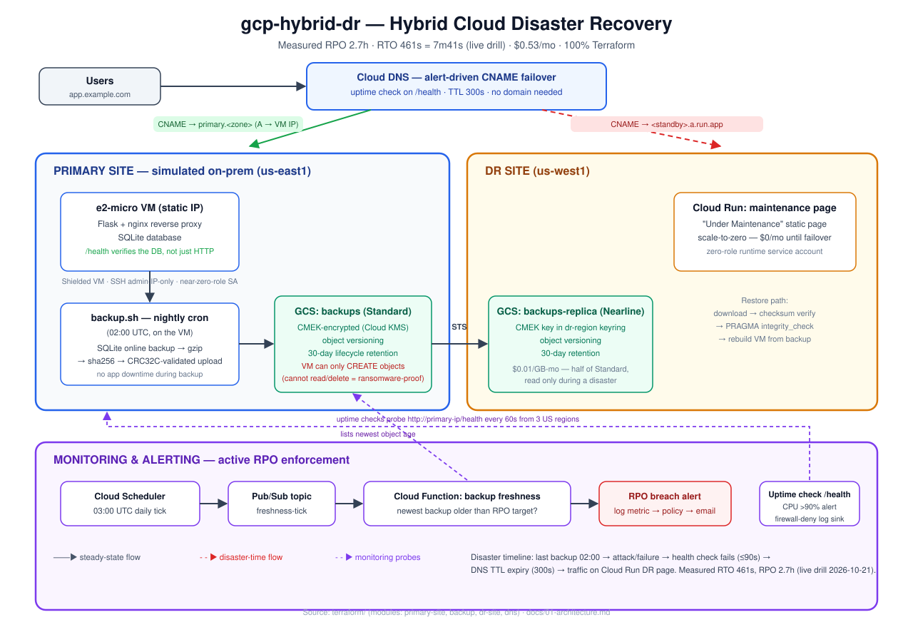

# GCP Hybrid Cloud Disaster Recovery

Disaster recovery with **measured** RPO/RTO: a primary site (e2-micro VM
simulating on-prem) backs up to a CMEK-encrypted Cloud Storage bucket,
replicates cross-region via Storage Transfer Service, and fails over to a
Cloud Run maintenance page by rewriting a CNAME record — automatically,
driven by a Cloud Monitoring alert.

**All numbers in this README were measured against a live deployment on
2026-10-21**, not estimated. See [docs/06-measurements.md](docs/06-measurements.md).

| Objective | Target | **Measured** |
|-----------|--------|--------------|
| RPO | < 24h | **2.7h** (2h 41m) — hourly cadence; the dial is a Terraform variable |
| RTO | < 5 min | **461-482s** across three live drills — from outage to users served, measured end to end |
| Cost | ≤ $2/mo | **$0.53/mo**, 100% Terraform |

Total cost: **$1.06** over two months — inside the $2 project budget.
No registered domain required.

## What Makes This Stand Out

Most "DR project" portfolios draw a diagram. This one **runs the outage**:

```bash
bash src/scripts/disaster-drill.sh --project YOUR_PROJECT \
  --zone us-east1-b --instance dr-demo-primary \
  --dns-name www.YOUR_ZONE. \
  --resolver $(terraform -chdir=terraform output -json dns_name_servers | jq -r '.[0]')
```

That command stops the primary VM for real, watches the alert fire, watches
the DNS record flip, confirms users are being served by the standby, brings
the VM back, and confirms the record is restored. The measured RTO is
written to `~/rto-drill-result.txt`.

The run that produced the numbers in this README:

```
[2026-10-21T17:43:18+00:00] stopping dr-demo-primary (simulated disaster)
[2026-10-21T17:43:40+00:00] VM stopped (+22s)
[2026-10-21T17:50:59+00:00] DNS www.dr-demo...example.com. -> dr-demo-dr-maintenance-...a.run.app.
[2026-10-21T17:50:59+00:00] endpoint answering 200 on /health via dr-demo-dr-maintenance-...a.run.app.
[2026-10-21T17:51:59+00:00] primary healthy again (34.23.59.120)
[2026-10-21T17:54:48+00:00] DNS restored -> primary.dr-demo...example.com. (primary)

=== MEASURED RTO ===
DR serving users  : +461s
```

Three drills, three times of day: **462s, 461s, 482s** — a 21-second
spread, and the full round trip (flip, serve, restore) every time.

Deploying it also **found 32 real bugs** that code review had missed —
including a backup pipeline that had *never once succeeded*, and an SSH
firewall rule that was open to the whole internet. See
[docs/06-measurements.md §12](docs/06-measurements.md).

## Verify It Yourself

Every claim in this README is checkable against the running system.
With the project deployed:

```bash
# The primary serves real data from SQLite
curl http://$(terraform output -raw primary_ip)/health
curl http://$(terraform output -raw primary_ip)/ | grep -o 'ORD-[0-9]*'

# The DNS failover path — no registered domain needed, just ask the
# zone's authoritative nameserver
dig @$(terraform -chdir=terraform output -json dns_name_servers | jq -r '.[0]') \
  www.YOUR_ZONE CNAME +short
#   -> primary.YOUR_ZONE   (healthy)   or   <standby>.a.run.app  (failed over)

# The standby is up and returns 503 + Retry-After for real requests
curl -si https://$(terraform output -raw dr_service_uri | sed 's|https://||')/ | head -3

# The backup is real, checksummed, and restorable
bash src/scripts/verify-backup.sh $(terraform output -raw backup_bucket)
#   -> OK: checksum verified, gzip intact, integrity_check ok, 5 order rows

# The replication actually replicated (different region, same bytes)
gcloud storage ls -l gs://$(terraform output -raw replica_bucket)/backups/ | tail -2

# The IAM is least-privilege: the VM can write backups but not read them
gcloud storage buckets get-iam-policy gs://$(terraform output -raw backup_bucket) \
  --format="value(bindings)"
#   -> the VM's SA has roles/storage.objectCreator ONLY

# The tests pass
pytest tests/ -v
```

## Problem Statement

Design a disaster recovery strategy that demonstrates backup automation,
DNS failover, recovery time objectives (RTO), and recovery point objectives
(RPO) with measurable results — on a student budget.

## Architecture



<details>
<summary>Text version (ASCII)</summary>

```
PRIMARY SITE (simulated on-prem)          DR SITE (GCP)
e2-micro VM (us-east1)                   Cloud Run (us-west1)
  Flask app + nginx                        "Under Maintenance" page
  SQLite database                          Scale-to-zero ($0/mo)
  /health endpoint
        |
        | cron (02:00 UTC default, hourly in the measured run)
        v
  backup.sh:
    SQLite online backup -> gzip -> sha256
    -> Cloud Storage JSON API (CRC32C validated, write-only IAM)
        |
        | Storage Transfer Service (04:00 UTC)
        v
  Cloud Storage: backups              Cloud Storage: backups-replica
    (Standard, us-east1)               (Nearline, us-west1)
    - CMEK encryption                   - CMEK encryption
    - 30-day retention + lock          - 30-day retention + lock
    - Versioning                        - Versioning
    - Write-only from VM                - Cross-region replica

DNS FAILOVER (automated, NO registered domain needed):
  Uptime check (/health from 3 US regions) -> primary_down alert
    Incident OPEN:   dns-failover function -> CNAME -> DR standby
    Incident CLOSED: dns-failover function -> CNAME -> primary target
    TTL: 300 seconds

  The public record is a CNAME between two HOSTNAMES:
    www.<zone>  CNAME -> primary.<zone>          (A -> the VM's IP)
              or -> <standby>.a.run.app          (the Cloud Run standby)
  A Cloud DNS zone is authoritative for its own name, so its
  nameservers answer queries directly — no domain purchase required.

MONITORING:
  Cloud Scheduler (03:00 UTC) -> Pub/Sub -> Cloud Function
    Lists backup bucket, checks newest backup age
    If > 24h (or no backups): RPO_BREACH log -> alert -> email

RESTORE DRILL:
  Cloud Scheduler (weekly, Sun 05:00 UTC) -> Pub/Sub -> Cloud Function
    Downloads newest backup, verifies sha256 manifest, gunzips,
    SQLite integrity_check + row count
    Any failure: RESTORE_DRILL_FAIL log -> alert -> email
```

</details>

Full details: [docs/01-architecture.md](docs/01-architecture.md)

## Tech Stack

| Layer | Technology |
|-------|------------|
| Cloud services | GCP: Compute Engine (e2-micro, primary site), Cloud Run (DR maintenance page), Cloud Storage (CMEK-encrypted, versioned, retention policy, cross-region replication via Storage Transfer Service), Cloud DNS (alert-driven CNAME failover), Cloud KMS (CMEK keys, 90-day rotation, automatic retirement of superseded versions), Cloud Scheduler, Pub/Sub, Eventarc, Cloud Functions 2nd gen (freshness sentinel + restore drill + DNS failover + key version retirement), Cloud Monitoring (uptime checks, CPU/RPO/drill alerting, DR-posture dashboard) |
| App runtime | **Measured on the live VM**: Python 3.11.2 + Flask 2.2.2 + Gunicorn 20.1.0 (primary, from Debian 12's apt), nginx 1.22.1 (reverse proxy). The DR maintenance page is nginx 1.27-alpine (container). The Cloud Functions are `python312`. |
| Backup | SQLite online backup API (safe while app serves traffic), gzip, sha256 checksums, Cloud Storage JSON API upload with `x-goog-hash: crc32c` (CRC32C validated) |
| IaC | Terraform >= 1.9 (the floor is set by the `import` block that adopts GCP's default firewall rules — import blocks are root-module only), hashicorp/google ~> 5.0, remote state in versioned GCS, 4 modules (`primary-site`, `backup`, `dr-site`, `dns`), validation blocks rejecting unsafe inputs |
| CI | GitHub Actions: terraform fmt/validate, Trivy IaC scan, ShellCheck, **pytest (74 tests)**, ruff (version pinned — see [requirements-dev.txt](requirements-dev.txt)), diagram-sync check |
| Tests | 74 unit tests over all four Cloud Functions, the Flask app, the shell backup pipeline and the drill's DNS/probe helpers — including a real SQLite→gzip→sha256→upload round trip against a stub GCS that **validates the CRC32C exactly as Cloud Storage does** |

## Cost Analysis

| Component | Monthly Cost | My Optimization |
|-----------|-------------|-----------------|
| e2-micro (primary) | $0.00 | Free tier in us-east1; 40 hrs/mo well under 720 |
| Cloud Run (DR) | $0.00 | Scale-to-zero; no traffic = no instances |
| Cloud Storage (backup, 5 GB Standard) | $0.10 | 30-day lifecycle, CMEK encryption |
| Cloud Storage (replica, 5 GB Nearline) | $0.05 | Nearline halves cost; 30-day minimum matches retention |
| Cloud KMS (2 keys) | $0.12 | 90-day rotation; keys never deleted |
| Cloud DNS (zone + health check) | $0.26 | Failover routing + health check |
| Cloud Scheduler + Pub/Sub | $0.00 | Free tier (3 jobs/day) |
| Cloud Functions (3) | $0.00 | ~40 invocations/mo, scale-to-zero |
| **Total** | **$0.53** | **$1.06** over two months, vs ~$8/mo if everything ran 24/7 |

Arithmetic: [docs/02-cost-analysis.md](docs/02-cost-analysis.md)

## Security Highlights

- **CMEK encryption** — both backup buckets encrypted with customer-managed
  keys; GCS service agent performs server-side encryption
- **Write-only backup access** — primary VM's SA has only `objectCreator`
  on the backup bucket (cannot list, read, overwrite, or delete); a
  compromised primary cannot destroy its own recovery path
- **The upload path preserves that guarantee** — `gcloud storage cp` reads
  the destination before writing, which write-only IAM forbids. The backup
  uploads through the JSON API's `uploadType=media`, which creates without
  reading. The property survives end to end.
- **Least-privilege DNS role** — a custom project role
  (`drFailoverDnsAdmin`) grants the failover function only record-set read/
  write and change permissions. It cannot create zones, delete them, or
  touch IAM. (`roles/dns.resourceRecordsAdmin` does not exist on GCP;
  `roles/dns.admin` would be far too broad.)
- **Cross-region replication** — Storage Transfer Service replicates
  server-side; no credentials on the VM for replication
- **Backup integrity** — SQLite online backup API (consistent snapshot),
  sha256 checksums, CRC32C on upload, PRAGMA integrity_check before and
  after
- **SSH hardening** — password auth disabled, root login disabled, OS
  Login disabled, admin-IP-only firewall rule — **and the GCP default
  `default-allow-ssh` rule (which allows SSH from `0.0.0.0/0`) is
  explicitly imported and disabled by Terraform.** The same treatment
  goes to `default-allow-rdp` (tcp:3389 from `0.0.0.0/0`): nothing on
  the VM listens on it, but disabling SSH and leaving RDP open is the
  kind of half-finished hardening a review is designed to catch
- **Failover refuses to fail over into a dead standby** — the function
  probes the standby's `/health` before repointing DNS

### Where the threat model stops

The design answers *"can an actor destroy the backups?"* — precisely
enough to be honest about which attackers are covered:

| Attacker | Covered? | By what |
|----------|----------|---------|
| Ransomware on the primary VM | ✅ **Yes** | The VM's SA is write-only. Verified from inside the VM: it can write, it cannot read. |
| Accidental overwrite | ✅ Yes | Object versioning |
| Regional outage (us-east1) | ✅ Yes | Continuous cross-region replication |
| A stolen bucket export | ✅ Yes | CMEK, 90-day rotation, key never leaves KMS |
| A corrupt backup | ✅ Yes | sha256 + integrity_check + CRC32C + weekly drill |
| A project-level `storage.admin` | ⚠️ Partially | Bucket retention policy blocks deletion of recent objects |
| **A principal who compromises the whole project** | ❌ **No** | Backups and keys live in the same project |

The last row is why a **cross-project backup replica** was designed —
a second copy in a second GCP project, so compromising one cannot
destroy both. **It is deliberately not deployed:** a second billable
project does not fit the shared $300 trial budget this whole portfolio
runs on, and the rest of the portfolio would carry that risk. The
design is written out in [MISSING.md](MISSING.md) and
[docs/03-security.md](docs/03-security.md) so it is a configuration
change, not a rewrite, if the budget ever allows it.

Details: [docs/03-security.md](docs/03-security.md)

## Scaling Path

"If this needed to support a real enterprise, I would..."
- e2-micro → actual on-prem with **Cloud Interconnect** ($1,700/mo)
- Daily backups → **continuous replication** (Cloud SQL read replicas)
- Cloud Storage → **dual-region** buckets for HA
- Cloud Run DR → **full GKE cluster** with automated failover
- RPO: 24h → **1h** with incremental backups (a variable change today)
- RTO: 5min → **30s** with load balancer health checks + warm standby
- Add: **Cloud Backup for GKE**, **Cloud DR** (managed service)

Details: [docs/04-scaling.md](docs/04-scaling.md)

## Quick Start

```bash
git clone <this-repo>
cd gcp-hybrid-dr

# 1. Create the project and link it to a billing account
gcloud projects create YOUR_PROJECT_ID --name="Your DR project"
gcloud beta billing projects link YOUR_PROJECT_ID \
  --billing-account=$(gcloud beta billing accounts list --format='value(name)' | head -1)

# 2. Create the least-privilege role the DNS failover function needs.
#    (roles/dns.resourceRecordsAdmin does not exist on GCP, and zone-level
#    IAM is broken for some accounts -- see docs/05-troubleshooting.md)
gcloud iam roles create drFailoverDnsAdmin --project=YOUR_PROJECT_ID \
  --title="DR DNS Failover Admin" \
  --permissions=dns.resourceRecordSets.create,dns.resourceRecordSets.delete,dns.resourceRecordSets.get,dns.resourceRecordSets.list,dns.resourceRecordSets.update,dns.changes.create,dns.changes.get,dns.changes.list,dns.managedZones.get,dns.managedZones.list

# 3. Create the Artifact Registry repo the DR image lives in.
#    Terraform manages this repo too, but the image has to be BUILT
#    before Terraform can deploy the service that runs it -- so create it
#    here first, and Terraform will import it rather than conflict.
#    (If you prefer, create the repo, run `terraform apply` once, then
#    build the image and re-apply.)
gcloud artifacts repositories create dr-demo-dr-site \
  --project=YOUR_PROJECT_ID --location=us-west1 \
  --repository-format=docker --description="DR maintenance-page image"

# 4. Build and push the DR maintenance page
gcloud auth configure-docker us-west1-docker.pkg.dev
gcloud builds submit src/dr-site \
  --project YOUR_PROJECT_ID \
  --tag us-west1-docker.pkg.dev/YOUR_PROJECT_ID/dr-demo-dr-site/maintenance:v1

# 5. Bootstrap remote state (one-time) and deploy
cd terraform
cp terraform.tfvars.example terraform.tfvars
# Fill in project_id, admin_ip_cidr, ssh_public_key, alert_email,
# dns_name, dns_failover_role_id, billing_account_id, billing_currency

../scripts/bootstrap-state.sh YOUR_PROJECT_ID   # versioned state bucket
terraform init -backend-config="bucket=YOUR_PROJECT_ID-tfstate"

# The Cloud Billing Budget API needs a quota project:
export GOOGLE_CLOUD_QUOTA_PROJECT=YOUR_PROJECT_ID

terraform plan && terraform apply

# 5. Verify the primary site is running
curl http://$(terraform output -raw primary_ip)/health

# 6. Run the disaster drill — this is the demo
bash ../src/scripts/disaster-drill.sh --project YOUR_PROJECT_ID \
  --zone us-east1-b --instance dr-demo-primary \
  --dns-name www.YOUR_ZONE. \
  --resolver $(terraform output -json dns_name_servers | jq -r '.[0]')

# 7. Verify a backup end to end
bash ../src/scripts/verify-backup.sh $(terraform output -raw backup_bucket)
```

Tear down: `terraform destroy`

## Scope — what's done, and what isn't

**Done and verified on live infrastructure:** automated backup with
write-only IAM and a validated CRC32C, cross-region replication, weekly
automatic restore drills, RPO monitoring, alert-driven DNS failover, a
DR-posture dashboard, 74 unit tests, and RPO/RTO measured across three
real outages.

**Two things are deliberately not in the build:**

| | Why | What covers it instead |
|---|---|---|
| 📸 **Screen recording** | Needs a human at a keyboard. Everything it would show now exists, is measured, and is verified — it is a *capture*, not a build. The exact shot list and timings are in [MISSING.md](MISSING.md). | — |
| ⏭️ **Cross-project backup replica** | A second billable GCP project does not fit the **$300 trial credit** shared across this 7-project portfolio; it would roughly double the fixed costs for a control improvement rather than a capability one. The design is written down so it is a config change, not a rewrite. | Write-only IAM (verified: the VM can write but not read), a locked bucket retention policy, versioning, continuous cross-region replication, CMEK, and a weekly restore drill. A principal able to remove the retention policy itself remains a threat — stated plainly in [docs/03-security.md](docs/03-security.md). |

Nothing else is outstanding.

**Where to look:**

| Document | What it covers |
|----------|----------------|
| [docs/01-architecture.md](docs/01-architecture.md) | The design, the data flow, and what is deliberately *not* in it |
| [docs/02-cost-analysis.md](docs/02-cost-analysis.md) | Every cost line, with the arithmetic shown |
| [docs/03-security.md](docs/03-security.md) | IAM, the integrity chain, and the threat model — including where it stops |
| [docs/04-scaling.md](docs/04-scaling.md) | Where the RTO actually goes, and the scaling paths |
| [docs/05-troubleshooting.md](docs/05-troubleshooting.md) | 11 real incidents with the exact error each produces |
| [docs/06-measurements.md](docs/06-measurements.md) | The measured run, the arithmetic, and the 32 bugs the deployment found |
| [docs/07-screenshot-runbook.md](docs/07-screenshot-runbook.md) | Step-by-step: what to capture, exactly how, and why each shot matters |
| [JOURNEY.md](JOURNEY.md) | 10 days of decisions, dead ends, and the mistakes |
| [MISSING.md](MISSING.md) | The scope statement: what is done, what is skipped and why |
| [gcp-checklist.md](gcp-checklist.md) | The quality/budget checklist, re-verified against the running system |

## What I Learned

The decisions, dead ends, and arithmetic are in [JOURNEY.md](JOURNEY.md) —
including the day I discovered the GCS service agent (not the uploader)
needs the KMS key, why SQLite's online backup API eliminated the need
to stop the app during backups, and the 32 bugs that only a real
deployment could surface.
